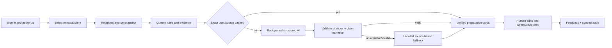
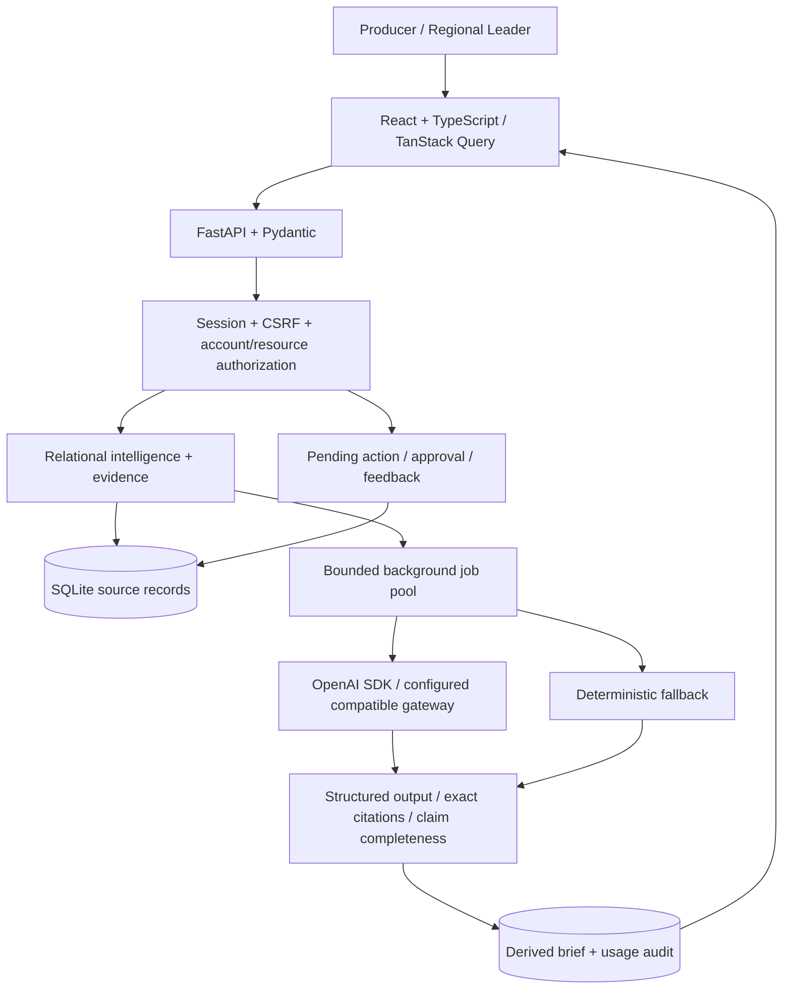
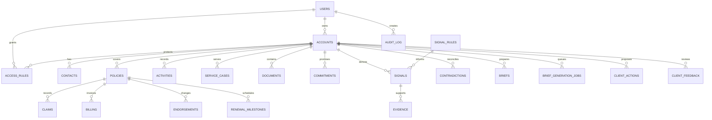

# Editable diagrams

## End-to-end journey

## Application architecture

## Logical ER model

Evidence/timeline polymorphic references are service-resolved, not direct SQL foreign keys.
Action/feedback entities are the newly added runtime schema; focused verification is pending.
