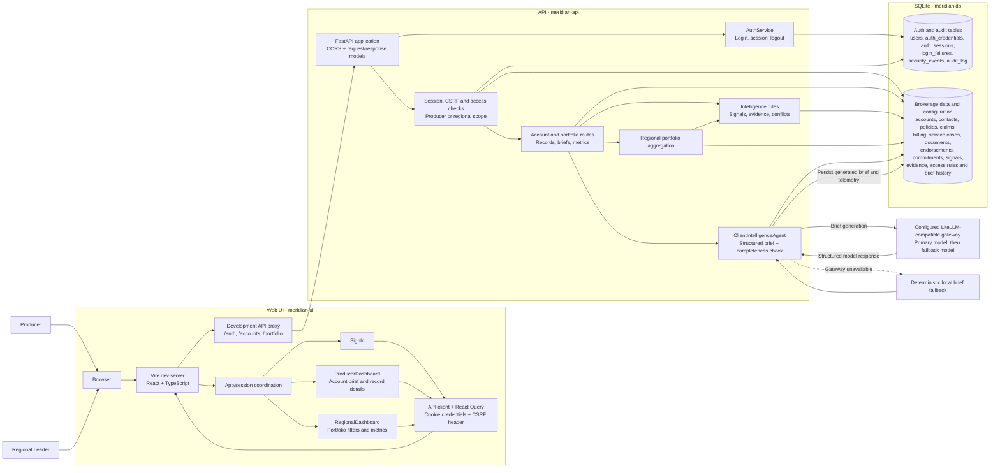

# Meridian Broker Solution Architecture

This diagram reflects the current API and UI implementation. The Vite proxy shown
below is for local development; production hosting and ingress are not defined by
the repository.

## Request and data flow

- The UI restores a cookie-backed session on startup. Sign-in and sign-out use
  `/auth/login` and `/auth/logout`; mutating requests include the session's CSRF
  token. A `401` on a protected request clears the UI session and cached data.
- Producers receive accounts in their assigned book. Regional leaders can read
  authorized accounts in their region and use `/portfolio` to filter and
  aggregate renewal, risk, claim, and commitment data.
- Account record endpoints and briefs are protected by both session checks and
  account/resource access rules. The API applies the same authorization scope
  when it builds account intelligence and portfolio aggregates.
- A regular brief read combines persisted broker data with rule-derived signals,
  supporting evidence, renewal milestones, and the latest generated brief.
  Generating a brief additionally calls the configured LLM gateway, checks
  structured output for completeness, persists the result and telemetry, and
  falls back to deterministic local generation if the gateway is unavailable.
- The API initializes synthetic SQLite data at startup according to
  `RESET_DB_ON_START`; security tables are initialized without resetting
  existing business data when needed.
